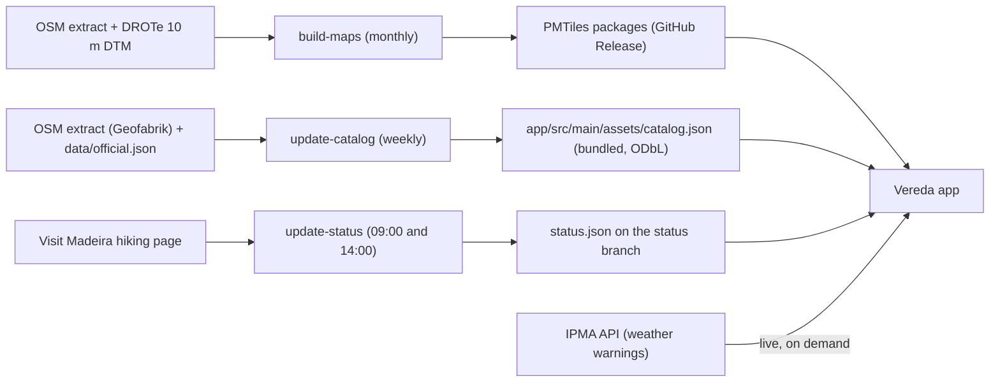

# Madeira Trails App — Build Spec

Oct 26, 2026 · @André

## Summary

**Vereda** (working name, rename freely) is an offline-first Android hiking app for Madeira and Porto Santo: a Gaia GPS-style topo map carrying every official PR trail plus the best community-mapped levadas and veredas, GPS recording and navigation, one-tap offline maps, and a local profile with Done / To-do / Wishlist lists. No account and no login.

Why it beats the global apps on this island:

- **Official status and booking on every PR trail** — open / partial / closed with a "checked X min ago" time, the 2026 fee, and a button to book on SIMplifica.
- **Sharper topo** — contours and hillshade built from Madeira's own 10 m terrain model, not global 30 m data.
- **The whole island offline in one tap** — Madeira and Porto Santo each ship as one package, so nobody has to draw download boxes before a hike.
- **Levadas as a first-class map feature** — channel, path, tunnels, exposed sections and shelters drawn distinctly.

**Decided:** Kotlin + Jetpack Compose · MapLibre Native · Room · free self-hosted map data (OpenStreetMap + DROTe 10 m DTM) published as static files on GitHub · PT-PT and EN at launch.

**How to use this with Claude Code**

1. Export this doc as Markdown and commit it as `docs/SPEC.md` in a new repo; save the UI design screens to `docs/design/`.
2. Ask Claude Code to build one phase at a time (see *Build phases*), and don't start the next phase until every acceptance box of the current one is ticked.
3. Treat `docs/SPEC.md` as the source of truth: change the spec first, then the code.

## Goals and principles

Version 1 succeeds if a first-time visitor can pick a trail, confirm it is open, book it, and walk it offline without getting lost — and a local can log every hike they do.

**Goals**

1. **Find a trail in under 30 seconds** — search by name or code ("pr6", "25 fontes"), filter by status, difficulty, length and area, or browse the map.
2. **Navigate safely with no signal** — trail line on a topo map, live position, distance and climb remaining, off-route alert.
3. **Record any hike and keep a personal log** — Done, To-do, Wishlist and custom lists, plus stats such as "official trails completed: 17 of 42".
4. **Never mislead about access** — official status with its check time and source, booking and fee shown before the user commits.

**Who it is for**

| User | Needs most |
| --- | --- |
| Visitors (most users) | Open/closed status, booking and fee, English, offline maps, simple safety info |
| Residents | Lesser-known trails and levadas, logging hikes, free entry but booking still required |
| Trail runners | Recording, pace, climb, exporting GPX to other tools |

**Principles**

- **No login.** The profile lives on the phone; backup is a file the user owns plus Android's built-in device backup.
- **Offline first.** Every screen works in airplane mode; only status, weather warnings and package updates need a connection.
- **Battery budget.** Target: a 6-hour hike with recording on uses under 25% of a Pixel 8-class battery.
- **Free to run.** No paid APIs and no server code; only static files on GitHub.
- **Honest data.** Every trail shows its source: Official (IFCN), Community (OpenStreetMap) or Imported.

**Not in version 1:** a Google Play release, accounts or cloud sync, reviews and social feed, photo sharing, road routing to the trailhead (hand off to Google Maps), iOS, Wear OS, payments or ads.

## Madeira rules the app must reflect

Since 1 January 2026 every classified (PR) trail needs a timed booking on SIMplifica before you start; visitors pay €4.50 per trail (PR 1: €10.50), while residents and children up to 12 walk free but must still book. Trails close often, and walking a closed one is an offence, so status is a core feature, not a nice-to-have.

| Rule (2026) | What the app does | Source |
| --- | --- | --- |
| Booking is mandatory for all PR trails, online only via SIMplifica; walking without one is an infraction | "Book on SIMplifica" button on every PR trail page and in the To-do reminder | [Visit Madeira FAQ](https://visitmadeira.com/en/travel-info/faq/) |
| Standard fee €4.50 per person; PR 1 €10.50; €3 when booked through protocol tour operators | Fee chip on cards and trail page, stored per trail in the catalog | [Visit Madeira FAQ](https://visitmadeira.com/en/travel-info/faq/), [Visit Madeira hiking](https://www.visitmadeira.com/en/what-to-do/nature-seekers/activities/hiking/) |
| Visitors 12 and under are exempt | "Free for 12 and under" line on the fee card | [PR 6 trail page](https://visitmadeira.com/en/what-to-do/nature-seekers/activities/hiking/pr-6-levada-das-25-fontes/) |
| Residents are free but must register and book | "I'm a Madeira resident" switch in the profile changes the fee card to "Free — booking still required" | [IFCN FAQ](https://ifcn.madeira.gov.pt/en/atividades-de-natureza/percursos-pedestres-recomendados/faq-s-taxas-percursos-pedestres-classificados/frequently-asked-questions-fees-classified-walking-routes.html) |
| Daily and 3- or 7-day passes are applied automatically at checkout when cheaper | Note on the fee card; no price maths in the app | [IFCN FAQ](https://ifcn.madeira.gov.pt/en/atividades-de-natureza/percursos-pedestres-recomendados/faq-s-taxas-percursos-pedestres-classificados/frequently-asked-questions-fees-classified-walking-routes.html) |
| Closed trails: access is a misdemeanour with fines of €250–€2,500 for individuals | Closed trails drawn red-dashed, Navigate blocked behind a warning | [DN Madeira, 2023](https://www.dnoticias.pt/2023/10/25/380569-turistas-identificados-pela-policia-florestal-na-vereda-do-areeiro/) |
| Status is published as an official PDF and on each Visit Madeira trail page, often with partial openings ("open to km 1.2") and detours | Status model has open / partial / closed / unknown plus a note and km range | [Status PDF](https://visitmadeira.com/media/rcradgkh/percursos-pedestres-classificados.pdf) |

Fees and rules change yearly, so they live in the catalog data, never hard-coded in the app code.

### Official trail list (catalog seed)

The IFCN list has 42 classified trails: 39 on Madeira and 3 on Porto Santo ([official list PDF](https://visitmadeira.com/media/rcradgkh/percursos-pedestres-classificados.pdf)). The data pipeline must match every code below to a geometry and fail loudly if one is missing.

| Code | Name (start – end) | Municipality |
| --- | --- | --- |
| PR 1 | Vereda do Pico do Areeiro (Pico do Areeiro – Pico Ruivo) | Santana |
| PR 1.1 | Vereda da Ilha (Pico Ruivo – Ilha) | Santana |
| PR 1.2 | Vereda do Pico Ruivo (Achada do Teixeira – Pico Ruivo) | Santana |
| PR 1.3 | Vereda da Encumeada (Pico Ruivo – Encumeada) | Ribeira Brava |
| PR 2 | Vereda do Urzal (Curral das Freiras – Boaventura) | Câmara de Lobos |
| PR 3 | Vereda do Burro (Pico do Areeiro – Ribeira das Cales) | Funchal |
| PR 3.1 | Caminho Real do Monte (Ribeira das Cales – Monte) | Funchal |
| PR 4 | Levada do Barreiro (Poço da Neve – Casa do Barreiro) | Funchal |
| PR 5 | Vereda das Funduras (Portela – Maroços) | Machico |
| PR 6 | Levada das 25 Fontes (Rabaçal – 25 Fontes) | Calheta |
| PR 6.1 | Levada do Risco (Rabaçal – Risco) | Calheta |
| PR 6.2 | Levada do Alecrim (Rabaçal – Nascente da Levada do Alecrim) | Calheta |
| PR 6.3 | Vereda da Lagoa do Vento (Rabaçal – Lagoa do Vento) | Calheta |
| PR 6.4 | Levada Velha do Rabaçal (Pico Gordo – Casa do Rabaçal) | Calheta |
| PR 6.5 | Vereda do Pico Fernandes (Paul da Serra – 25 Fontes) | Calheta |
| PR 6.6 | Vereda do Túnel do Cavalo (Zona de Lazer da Caldeira – Casa do Rabaçal) | Calheta |
| PR 6.7 | Vereda da Câmara de Carga do Rabaçal (Rabaçal – Túnel do Cavalo) | Calheta |
| PR 6.8 | Levada do Paul II – Um Caminho Para Todos (Rabaçal – Estrada do Rochão) | Calheta |
| PR 7 | Levada do Moinho (Ribeira da Cruz – Lamaceiros) | Porto Moniz |
| PR 8 | Vereda da Ponta de São Lourenço (Baía d'Abra – Cais do Sardinha) | Machico |
| PR 9 | Levada do Caldeirão Verde (Queimadas – Caldeirão Verde) | Santana |
| PR 9.1 | Levada do Caldeirão Verde – Um Caminho para Todos (Queimadas – Pico das Pedras) | Santana |
| PR 10 | Levada do Furado (Ribeiro Frio – Portela) | Machico |
| PR 11 | Vereda dos Balcões (Ribeiro Frio – Balcões) | Santana |
| PR 12 | Caminho Real da Encumeada (Boca da Corrida – Encumeada – Ribeira Grande) | Ribeira Brava |
| PR 13 | Vereda do Fanal (Assobiadores – Paul da Serra – Fanal) | Porto Moniz |
| PR 13.1 | Vereda da Palha Carga (Louro da Gota – 25 Fontes) | Porto Moniz |
| PR 14 | Levada dos Cedros (Fanal – Curral Falso) | Porto Moniz |
| PR 15 | Vereda da Ribeira da Janela (Curral Falso – Ribeira da Janela) | Porto Moniz |
| PR 16 | Levada Fajã do Rodrigues (Fajã da Amã – Ribeira da Janela) | São Vicente |
| PR 17 | Caminho do Pináculo e Folhadal (Lombo do Mouro – Folhadal – Encumeada) | Ribeira Brava |
| PR 18 | Levada do Rei (Quebradas – Ribeiro Bonito) | Santana |
| PR 19 | Caminho Real do Paul do Mar (Prazeres – Paul do Mar) | Calheta |
| PR 20 | Vereda do Jardim do Mar (Prazeres – Jardim do Mar) | Calheta |
| PR 21 | Caminho do Norte (Encumeada – Ribeira Grande) | São Vicente |
| PR 22 | Vereda do Chão dos Louros | São Vicente |
| PR 23 | Levada da Azenha (Azenha – Caminho Velho do Castelo) | Santa Cruz |
| PR 27 | Glaciar do Planalto (Bica da Cana – ER105) | Calheta |
| PR 28 | Levada da Rocha Vermelha (Fanal – Lombo do Atouguia) | Calheta |
| PS PR 1 | Vereda do Pico Branco e Terra Chã (ER 111 – Terra Chã) | Porto Santo |
| PS PR 2 | Vereda do Pico do Castelo (Moledo – Pico do Castelo) | Porto Santo |
| PS PR 3 | Levada do Pico do Castelo (Camacha – Ribeiro Formoso – Capela da Graça) | Porto Santo |

### Beyond the famous trails

You asked for lesser-known official trails and anything with a usable GPX. The catalog takes these in, in this order of trust:

1. **The quieter official PRs** — PR 6.3 to 6.8, 13.1, 16, 22, 23, 27, 28 and the Porto Santo trails get the same status, fee and booking treatment as the famous ones. PR 6.8 and PR 9.1 are signed "Um Caminho Para Todos" and get an *Accessible* tag and filter.
2. **Other official routes** — the Parque Ecológico do Funchal 18.8 km loop that [Visit Madeira lists](https://visitmadeira.com/pt/o-que-fazer/exploradores-da-natureza/atividades/trail-running/parque-ecologico-do-funchal/) as a trail-running route, and the planned 93 km Grande Rota from Porto Moniz to Machico ([DN Madeira](https://www.dnoticias.pt/2023/4/14/356039-governo-lanca-empreitada-pedestre-grande-rota/)), which is not on the 2026 list yet. The data model supports GR routes so it can be added the day it is published.
3. **Community trails from OpenStreetMap** — unclassified but popular paths such as Levada Nova, Levada do Moinho (Ponta do Sol), Levada da Ribeira da Janela, Vereda do Galhano and Levada do Brasileiro ([DN Madeira](https://www.dnoticias.pt/2023/10/16/379314-percursos-pedestres-dos-concelhos-afectados-pelos-incendios-reabertos/)). These have no official status or maintenance, so they carry a "Not officially maintained" banner.
4. **GPX you bring yourself** — files from guidebooks, Wikiloc or friends are imported privately on the device. They can't be bundled in the app unless their licence allows redistribution (see *Data sources*).

## Features

Version 1 ships nine feature areas; items tagged **(later)** wait for version 1.x. Everything not tagged is in scope for v1.

### 1. Map (home tab)

- Full-screen topo map, opening on the whole island or the last viewed area.
- **Layers sheet** (stack icon, as in Gaia GPS): base map Topo (default) or Satellite **(later, online only)**; overlays switched on and off individually — official trails, community trails, levadas, contour lines, hillshade (with intensity slider), points of interest, my tracks.
- Official trails drawn by status: open green, partial amber, closed red dashed, unknown grey. Community trails blue-grey dashed.
- **Tap a trail** → bottom sheet peek: code badge, name, distance, climb, time, status chip, fee chip, buttons *Details* and *Navigate*.
- Controls: locate me (cycles follow → follow with heading → free), compass reset, scale bar.
- **Long-press** a point → coordinates (decimal and UTM zone 28N), terrain elevation, *Save waypoint*, *Share location*.
- Measure-distance tool **(later)**.
- Search bar on top; red record button bottom-right.

### 2. Explore (trail catalog)

- AllTrails-style list of cards with a map toggle. Card: elevation sparkline or photo, code badge, name, area, distance, time, climb, difficulty, route type, status chip, fee chip.
- **Quick chips:** Open now · Under 2 h · Levadas · Peaks · Accessible · Porto Santo · Near me.
- **Filters sheet:** source (official / community / my imports), status, difficulty, distance range, climb range, duration, route type (loop, out and back, one way), municipality, features (waterfall, viewpoint, tunnel, laurel forest, accessible, family friendly).
- **Sort:** nearest, shortest, longest, most climb, code order, A–Z.
- Default: official trails first, "Open now" on.

### 3. Trail page

- Map preview with the line, start and end markers and km ticks; tap to open full map.
- **Status banner:** state, note ("open to km 1.2"), "checked 18 min ago", link to the official page. Stale data (over 24 h) shows as *Unknown — check the official page*, never as open.
- **Access card:** fee, "Free for residents and 12 and under", *Book on SIMplifica* (opens browser), booking reminder.
- **Stats:** distance, estimated time, climb and descent, highest and lowest point, route type, difficulty. Official values win when published; otherwise computed (see *Data model*).
- **Elevation profile:** drag along it to show the matching point on the map.
- **About:** a short original summary (2–4 sentences, written by us, not copied) and a link to the official description.
- **On the trail:** tunnels (bring a torch), exposed or vertigo sections, shelters, water, toilets, parking, nearest bus stop.
- **Actions:** Save (Done / To-do / Wishlist / custom list), Navigate, Download offline map, Export GPX, Share, Directions to start (opens Google Maps).
- **Your history** on this trail: dates done and linked recordings.

### 4. Navigate and record

- **Navigate a trail:** line highlighted, progress along it, distance, climb and time remaining, next feature ("tunnel in 400 m").
- **Off-route alert:** vibration and notification when more than 40 m from the line for over 30 s (both adjustable); no alerts during GPS gaps such as tunnels.
- **Record:** start, pause, resume, stop; live time (moving and total), distance, pace, altitude, climb and descent.
- Runs with the screen off in a foreground service; notification shows live stats with Pause and Stop.
- Add a waypoint while recording; photo and note on waypoints **(later)**.
- **On stop:** name it, trim start and end, save. If the track overlaps an official trail by 70% or more, offer "Mark PR 6 as done".
- Crash-safe: points are saved every 10 s and recording resumes after the app is killed.

### 5. Offline maps

- **One-tap package:** *Madeira and Porto Santo* (one package since Phase 1, see there), holding base map, contours and hillshade. Size shown before download, Wi-Fi-only switch, progress, pause and resume, checksum check, "update available".
- A small overview map (zoom 0–11) ships inside the app so the map is never blank.
- The trail catalog and status are small and refresh in the background.
- **Storage screen:** packages with size, version date, update and delete.
- Gaia-style draw-a-box downloads **(later)**, only needed for the satellite layer.

### 6. Profile and lists (no login)

- **Profile:** display name, photo or initials, "I'm a Madeira resident" switch, units, language.
- **Done** = trails completed, each with date, optional linked recording, rating (1–5) and private note.
- **To-do** = planned trails with an optional date; the day before, a reminder says "Check status and book".
- **Wishlist** = someday trails. **Custom lists** such as "With kids" or "Winter walks".
- **Stats:** km walked, metres climbed, hikes, official trails done (progress ring, x of 42), per year. Heatmap of my tracks and badges **(later)**.
- **Saved:** my recordings, waypoints and imports, sortable into folders (as in Gaia GPS).
- **Backup:** export everything to one .zip (JSON plus GPX files) and import it back; Android device backup enabled for the database and settings (map packages excluded).

### 7. Search

- One box for trails (name, code like "pr6" or "6.1", aliases like "25 fontes"), places (peaks, villages, viewpoints) and coordinates (decimal, DMS, UTM).
- Accent-insensitive ("caldeirao" finds "Caldeirão"), works offline, keeps recent searches.

### 8. GPX import and export

- Import GPX, KML or GeoJSON from the file picker or Android's share / "Open with".
- Imported trails get stats computed from the terrain model and can join any list.
- Export any trail or recording as GPX 1.1 with attribution in the metadata.

### 9. Safety

- **Emergency card:** call 112, large coordinates, "Share my location" by SMS with a Google Maps link (works with no data).
- **Weather warnings** from IPMA for the trail's area, shown on the trail page and before starting.
- Sunset time and "daylight left" while recording.
- Trail-specific checklist before starting (torch for tunnels, water, layers, booking done).
- Low-battery warning at 20% while recording.
- First-launch disclaimer: conditions change; official closures always win over the app.
- **Fall alert (later, noted 26 Oct 2026):** while a hike is being recorded, the accelerometer and gyroscope watch for a fall (free fall, a hard impact, then no movement). A loud alarm with a 30–60 s countdown lets you cancel; if nobody cancels, the app sends an SMS with your position and a map link to the emergency contacts set in *Me*, and can ring one of them. Android does not let apps place a 112 call on their own (`ACTION_CALL` refuses emergency numbers), so 112 is one tap on the alarm screen, not automatic. Needs the Phase 3 recording service (sensors keep running with the screen off), the `SEND_SMS` and `CALL_PHONE` permissions (fine for a sideloaded app, restricted on Google Play), and a field test for false alarms (phone dropped, thrown in a bag). Tracked in GitHub issue "Fall alert".

## Data sources and licensing

Every map and trail byte in the app comes from open data we are allowed to redistribute; official status and fees are facts we link to, and descriptions are written by us.

| Data | Source | Licence | Used for |
| --- | --- | --- | --- |
| Roads, paths, levadas, places, POIs | OpenStreetMap (Geofabrik Portugal extract, clipped to Madeira and Porto Santo) | ODbL 1.0 | Base map, POIs, search, community trails |
| Official trail lines | OSM hiking route relations tagged `ref=PR…`, e.g. [PR14 Levada dos Cedros](https://osm.org/relation/2239199), which already carry from/to, distance and the Visit Madeira link | ODbL 1.0 | Trail geometry |
| Terrain, Madeira | [DROTe 10 m Digital Terrain Model](https://dados.gov.pt/en/datasets/modelo-digital-do-terreno-mdt-da-ilha-da-madeira/) on dados.gov.pt (also a [5 m 2018/19 model](https://snig.dgterritorio.gov.pt/rndg/srv/api/records/cb85978f-afa9-4b9a-b5ed-ae7628372e11) with unclear terms) | CC BY 4.0 | Contours, hillshade, elevation profiles, climb |
| Terrain, Porto Santo | [DROTe 10 m DTM service](https://snig.dgterritorio.gov.pt/rndg/srv/api/records/7241ad17-d659-4c95-9101-770fbe345904) | To verify; fallback Copernicus GLO-30 | Same as above |
| Official list, status, fees | Visit Madeira trail pages and status PDF; IFCN | Government publication — store facts and links only, never copy text or photos | Catalog metadata, status |
| Weather warnings | IPMA open data API | Free, attribution to IPMA | Warnings card |
| Fonts and icons | Noto Sans (glyph PBFs), Material Symbols | OFL / Apache 2.0 | Labels, UI |

**Attribution line** (map corner and About screen): "© OpenStreetMap contributors · Terrain © DROTe · Status: IFCN / Visit Madeira · Warnings © IPMA". DROTe asks for the credit "Informação geográfica cedida pela Direção Regional do Ordenamento do Território" or "© DROTe" ([terms](https://snig.dgterritorio.gov.pt/rndg/srv/api/records/0bcce93f-12e4-44ec-90b8-4fb42fe49b15)).

**ODbL obligation:** the trail catalog is a derived database, so it is published under ODbL in this public repo with attribution. That costs nothing and keeps the app clean.

**The GPX rule:** a GPX is bundled only if its licence allows redistribution (OSM, open-data portals, Creative Commons without NC for a free app is fine). GPX files from AllTrails, Wikiloc, komoot or guidebooks stay private imports on the user's phone.

**Don't use** the public tile servers of OpenStreetMap or OpenTopoMap: the OSM policy forbids bulk downloads for offline use and heavy app traffic ([OSM tile policy summary](https://b4x.com/android/forum/threads/open-street-maps-not-working.143697/?amp=1)). Self-hosted files avoid that entirely.

## Data pipeline

The data jobs live in this repo under `data/` (Python, tested with pytest in CI) and run as scheduled GitHub Actions; the app only ever downloads static files, so there is no server to run or pay for.



Only the IPMA weather warnings and the trail status are fetched live; the catalog ships inside the APK and is refreshed by a new build.

| Job | Runs | Does | Publishes |
| --- | --- | --- | --- |
| `build-maps` (`.github/workflows/build-maps.yml`) | Monthly (3rd, 04:17 UTC) + manual; push to `maps-build` = test build | Downloads the DROTe terrain models (WCS) and cleans them; Planetiler builds the OpenMapTiles base map (z0–14) from the `osm-extract` release; GDAL `gdal_contour` (10 m interval, 50 m index) + tippecanoe builds contour tiles (z11–14); `build_dem_tiles.py` encodes the terrain as Terrarium lossless WebP tiles (z8–14, sea tiles left out); `build_elevation.py` writes the app's elevation grid | `madeira-base.pmtiles`, `madeira-contours.pmtiles`, `madeira-dem.pmtiles` on the release `maps-YYYY.MM.DD`; `manifest.json` on `maps-latest`; `elevation.bin`, `overview.pmtiles` and `glyphs/` committed to `main`, then an APK build |
| `update-catalog` (`data/scripts/build_catalog.py`) | Mondays + manual | Reads the Geofabrik Portugal extract clipped to Madeira with osmium (pyosmium); falls back to three small Overpass queries over four mirrors (the public Overpass servers ask automated jobs not to rely on them). Takes hiking/foot relations, named paths and named peaks; official trails matched by PR ref, then by official name; other named routes and named paths (≥ 400 m, not streets) become community trails; lines chained and simplified (Douglas-Peucker 3 m), stored as encoded polylines (precision 1e5) | `app/src/main/assets/catalog.json` + `data/catalog-report.md` (match count, missing codes, checklist of `data/wanted.json`), committed to `main`; then starts a new APK build. Community trails matching a `wanted.json` entry get its `searchAlias`, so "Boca da Corrida – Pico Grande" finds "Vereda do Pico Grande". Since Phase 0.6 it also cleans names, adds each trail's area and road access (`ends`), and collects points of interest; the clipped extract is kept on the `osm-extract` release |
| `update-status` (`data/scripts/build_status.py`) | 09:00 and 14:00 Madeira time + manual (owner's choice, 26 Oct 2026; was every 30 min) | Reads the [Visit Madeira hiking page](https://www.visitmadeira.com/en/what-to-do/nature-seekers/activities/hiking/), which shows every listed trail as Open / Restricted / Closed; needs at least 30 trails or it counts as a failure | `status.json` + `rows.txt` on the `status` branch (one force-pushed commit), read by the app from `https://raw.githubusercontent.com/Psy8891/Madeira-Trails-/status/status.json` |

**`data/official.json` is the hand-kept list of the 42 official trails** (code, name, island). It grows into the curated record described below (official URL, fee, official distance and duration, difficulty, aliases, feature tags) and is the place to fix anything OSM gets wrong.

**`data/wanted.json` is the checklist of popular unofficial walks** taken from guides (Boca da Corrida – Pico Grande, Vereda do Larano, Caminho da Entrosa, Levada Nova, Levada do Moinho, …). The catalog report shows which of them OSM already maps; missing ones are fixed by mapping them in OSM, never by copying GPX from AllTrails, Wikiloc or guidebooks.

**Status rules (safety-critical):**

- A parse failure keeps the last good value and sets `stale: true`; nothing is ever guessed as open.
- Every entry carries `checkedAt` and `sourceUrl`; the app shows the age and treats anything older than 24 h, or marked stale, as unknown.
- Trails missing from the page (PR 6.7 and PR 23 as of 26 Oct 2026) stay unknown.
- "Restricted" on the page maps to `partial`.
- The official status PDF is not used: on 26 Oct 2026 it still showed PR 1 partly closed months after it reopened.
- Later: `status-overrides.yaml` to set a status by hand (with expiry) when the official page lags behind the news.
- Be polite to the source: one request per page per run, a clear User-Agent with contact email, honour errors.

**Elevation stats:** sample the DTM every 10 m along the line, smooth with a 3-point median, count climb only on changes of 3 m or more. Estimated time when no official figure exists: 4 km/h on the flat plus 1 h per 600 m of climb (Naismith-style), rounded to 15 min.

**Package manifest** — the app reads `manifest.json` to know what exists:

```json
{
  "schema": 1,
  "packages": [{
    "id": "madeira",
    "name": "Madeira and Porto Santo",
    "version": "2026.10.27",
    "minApp": 1,
    "files": [
      {"role": "base", "url": "https://github.com/Psy8891/Madeira-Trails-/releases/download/maps-2026.10.27/madeira-base.pmtiles", "bytes": 0, "sha256": "…"},
      {"role": "contours", "url": "…/madeira-contours.pmtiles", "bytes": 0, "sha256": "…"},
      {"role": "dem", "url": "…/madeira-dem.pmtiles", "bytes": 0, "sha256": "…"}
    ]
  }]
}
```

Written by `data/scripts/build_manifest.py`; parsed and checked (https only, SHA-256 present, size above 0, schema not newer than the app) by `:core:maps` `MapManifest`. The app reads it from the `maps-latest` release. Real sizes are in the release notes of each build.

## App architecture

A native, single-activity Kotlin app: Compose for UI, MapLibre for the map, Room as the single source of truth, and a location foreground service for recording.

| Concern | Choice | Notes |
| --- | --- | --- |
| Language / UI | Kotlin 2.x, Jetpack Compose, Material 3, Navigation Compose | MVVM with unidirectional data flow: `UiState` in a `StateFlow` per screen |
| SDK levels | `compileSdk 36`, `targetSdk 36`, `minSdk 26` | Google Play has required API 36 for new apps and updates since 31 Aug 2026 ([Google Play](https://support.google.com/googleplay/android-developer/answer/11926878?hl=en-419)) |
| Map | MapLibre Native Android 13.x (`org.maplibre.gl:android-sdk`) wrapped in `AndroidView` | 13.0 made Vulkan the default; `android-sdk-opengl` is the fallback artifact if a device misrenders ([MapLibre](https://maplibre.org/news/2026-03-03-maplibre-newsletter-february-2026/)) |
| Offline tiles | PMTiles read with `pmtiles://file://<absolute path>` from app storage | `pmtiles://asset://` is not supported, so the bundled overview pack is copied from assets to `filesDir` on first launch; PMTiles sources don't use MapLibre's offline packs ([MapLibre PMTiles](https://maplibre.org/maplibre-native/android/examples/data/PMTiles/)) |
| Database | Room with an FTS4 table for search | Single source of truth; repositories expose `Flow` |
| Settings | DataStore (Preferences) | Profile, units, language, recording options |
| DI / async | Hilt, Coroutines and Flow |  |
| Background | WorkManager for catalog/status refresh and package downloads; a foreground service (type `location`) for recording and navigation |  |
| Location | Fused Location Provider; plain `LocationManager` GPS as fallback on devices without Google services |  |
| Network | OkHttp + kotlinx.serialization; resumable Range downloads with SHA-256 check |  |
| GPX | Own GPX 1.1 reader/writer on `XmlPullParser` | Small, fully unit-tested |
| Charts | Elevation profile drawn on a Compose `Canvas` | No chart library |

**Modules**

| Module | Owns |
| --- | --- |
| `:app` | Activity, navigation graph, theme, DI setup |
| `:core:model` | Plain Kotlin data classes shared everywhere |
| `:core:data` | Room database, DAOs, repositories, catalog/status sync, backup export/import |
| `:core:map` | MapLibre wrapper, style JSON, layer and source management, camera helpers |
| `:core:location` | Recording service, location filters, track statistics, off-route detection |
| `:core:geo` | GPX/KML/GeoJSON parsing, polyline maths, DEM sampling, coordinate formats (UTM 28N) |
| `:core:download` | Package manifest, downloads, checksum, storage management |
| `:feature:map`, `:feature:explore`, `:feature:trail`, `:feature:record`, `:feature:offline`, `:feature:me`, `:feature:search`, `:feature:settings` | One screen group each: Composables + ViewModel |

Keep business logic (stats, off-route, status freshness, search normalisation) in plain Kotlin inside `:core:*` so it runs in fast JVM unit tests.

## Data model

Trails and status arrive from the catalog and are replaced on each sync; everything the user creates lives in separate tables that a sync never touches.

**Room entities**

| Entity | Key fields | Notes |
| --- | --- | --- |
| `Trail` | `id` ("pr-6", "osm-r2239199", "imp-\<uuid>"), `source` (OFFICIAL, COMMUNITY, IMPORT), `code`, `name`, `island`, `municipality`, `lengthM`, `ascentM`, `descentM`, `minAltM`, `maxAltM`, `durationMin`, `difficulty`, `routeType` (LOOP, OUT\_AND\_BACK, ONE\_WAY), `start`/`end` lat-lon, `bbox`, `featureTags`, `feeEur`, `officialUrl`, `catalogVersion` | Imports are never deleted by a sync |
| `TrailGeometry` | `trailId`, `polyline` (encoded, 1e6 precision), `profile` (distance/elevation pairs) | Separate so lists load fast |
| `TrailStatus` | `trailId`, `state` (OPEN, PARTIAL, CLOSED, UNKNOWN), `noteEn`, `notePt`, `sourceUrl`, `checkedAt`, `fetchedAt` | UI computes freshness from `checkedAt` |
| `TrailFts` | name, code variants ("pr6", "pr 6", "6"), aliases, municipality, all accent-folded | FTS4 |
| `UserList` | `id`, `name`, `type` (TODO, WISHLIST, CUSTOM), `sortOrder` | TODO and WISHLIST created on first launch |
| `ListEntry` | `listId`, `trailId`, `addedAt`, `plannedDate?`, `note?` |  |
| `Completion` | `id`, `trailId`, `date`, `trackId?`, `rating?`, `note?` | "Done" = trails with at least one completion; marking Done removes the trail from To-do |
| `Track` | `id`, `name`, `startedAt`, `endedAt`, `distanceM`, `movingS`, `totalS`, `ascentM`, `descentM`, `maxAltM`, `trailId?`, `state` (RECORDING, PAUSED, DONE), `folderId?` |  |
| `TrackPoint` | `trackId`, `seq`, `time`, `lat`, `lon`, `altGps?`, `altDem?`, `accuracyM`, `segment` | Index on (`trackId`, `seq`); a new `segment` after each pause |
| `Waypoint` | `id`, `trackId?`, `name`, `lat`, `lon`, `alt?`, `note?`, `createdAt`, `folderId?` |  |
| `Folder` | `id`, `name`, `parentId?` | Saved items, Gaia-style |
| `MapPackage` | `id`, `version`, `state`, `bytesTotal`, `bytesDone`, `path`, `sha256` |  |

**catalog.json** (as built today; one entry of each kind shown):

```json
{
  "schema": 1,
  "generatedAt": "2026-10-26T14:00:00Z",
  "attribution": "© OpenStreetMap contributors (ODbL)",
  "trails": [
    {"id": "pr-6", "source": "official", "code": "PR 6", "name": "Levada das 25 Fontes", "island": "madeira",
     "lengthM": 4300, "osm": ["r2239199"], "lines": ["_p~iF~ps|U_ulLnnqC…"]},
    {"id": "osm-r4444478", "source": "community", "name": "Vereda do Pico Grande", "from": null, "to": null,
     "island": "madeira", "lengthM": 5100, "sacScale": null, "osm": ["r4444478"], "lines": ["…"],
     "area": "Serra de Água",
     "ends": [
       {"lat": 32.7186, "lon": -16.9939, "approachM": 2400, "road": "ER 228",
        "access": [32.7085, -16.9727], "parking": [32.7087, -16.9725], "via": ["Caminho Real da Encumeada"],
        "line": "…"},
       {"lat": 32.737, "lon": -16.988, "approachM": null}
     ]}
  ],
  "places": [
    {"name": "Pico Grande", "kind": "peak", "lat": 32.7146, "lon": -16.993, "ele": 1654, "aliases": ["Grande"]},
    {"name": "Miradouro do Pináculo", "kind": "viewpoint", "lat": 32.66, "lon": -16.87},
    {"kind": "parking", "lat": 32.7087, "lon": -16.9725}
  ]
}
```

`lines` holds one or more encoded polylines (Google format, precision 1e5). Community trails can carry `aliases` and a `noteEn`/`notePt` from `data/wanted.json` (e.g. that OSM maps only the summit part of Pico Grande); places carry other OSM names as `aliases`, because OSM names many Madeira peaks without "Pico" ("Grande", "Ruivo"), and search also tries "Pico <name>". An official trail is matched by its PR ref first; a relation that only shares an official trail's name is used for it only when no relation carries that ref (there is a Levada do Moinho in Porto Moniz, PR 7, and another in Ponta do Sol). All 42 official trails are always listed; one without an OSM line has `"lines": []` and the app says the line is missing instead of hiding the trail.

Added in Phase 0.6:

- **Full names.** A peak's `name` is the name people use: when OSM names it with a bare word ("Grande", "Ruivo", "Alto") or starts with "do/da", the catalog writes "Pico Grande" and keeps the OSM name in `aliases`. Community trail names are cleaned: stray symbols trimmed ("^Percurso de Treino"), `name:pt` used when the main name is in another language ("Umgehungsvariante für Tunnel"), capitals after "da/do/das/dos/de" lowered, and fixes from `data/name-fixes.json` (keyed by OSM id) applied last. The report lists names that still look odd.
- **`area`**: the nearest village, town or named locality (OSM `place=*`) to the middle of the line, so a community trail reads "Vereda do Pico · near Santo António" in search instead of a bare name. Official trails keep their curated start and end names.
- **`ends`**: up to two entries, start first. For each end of the main line, the job walks the OSM path network (paths, footways, steps, tracks and the other trails) to the nearest point a car can reach (a public road, not a track), up to 5 km. `approachM` is that walk (0 when the end is on a road, null when no road is found within 5 km), `line` its encoded line, `access` the road point, `road` the road's ref or name, `parking` the nearest parking within 300 m of `access`, `via` the names of the paths used. The end with the shorter approach is the start. This is what makes a trail like Pico Alto, which starts in the middle of other trails, possible to find from the road.
- **`places`** now holds points of interest as well as peaks, from OSM: `peak`, `viewpoint`, `waterfall`, `spring`, `water` (drinking water), `shelter`, `hut`, `picnic`, `camp`, `cave`, `toilets`, `parking`, `bus_stop` and `tunnel` (each end of a tunnel on a footpath or levada). `name` is optional except for peaks. Parking, toilets and bus stops are kept only within 400 m of a trail or an access point, so towns don't fill the map.

Added in Phase 0.7:

- **`starts`** on trails and on places with `access`: up to 3 ways in, recommended first, each in the same form as `access` plus optional `name` and `known`. Entries from `data/known-starts.json` (hand-checked trailheads such as Boca da Corrida for Pico Grande, Achada do Teixeira and Pico do Areeiro for Pico Ruivo) come first and carry `"known": true`; the others are the nearest road points found by the path-network search, at most 1.6 × the shortest walk + 1 km and 6 km in all, each on a different road and at least 300 m from the others. For a trail they lead to its start (`ends[0]`); `ends[0]` keeps the shortest one as before.

Later schema versions add the curated fields (municipality, fee, official URL, duration, difficulty, route type, elevation profile, feature tags, aliases).

**status.json:**

```json
{
  "schema": 1,
  "generatedAt": "2026-10-26T14:07:00Z",
  "ok": true,
  "source": "https://www.visitmadeira.com/en/what-to-do/nature-seekers/activities/hiking/",
  "trails": {
    "pr-7": {"code": "PR 7", "state": "closed", "label": "Closed",
             "sourceUrl": "https://www.visitmadeira.com/en/what-to-do/nature-seekers/activities/hiking/pr-7-levada-do-moinho/",
             "checkedAt": "2026-10-26T14:07:00Z", "stale": false}
  }
}
```

`state` is `open`, `partial` or `closed`. When a run fails, `ok` is false, `error` says why, and every entry keeps its old `checkedAt` with `"stale": true`.

**Backup .zip:** `backup.json` (lists, entries, completions, tracks without points, waypoints, folders, profile) + `tracks/<id>.gpx` + `imports/<id>.gpx`. Versioned with `"schema": 1`; import merges by id and never deletes.

## Screens and navigation

Four bottom tabs — **Map · Explore · Record · Me** — with search on top of Map and Explore. The visual designs are in the [Vereda UI design canvas](https://claude.ai/artifact/Cr57XLNKvr6EDJ9Pr7B77g) (nine phone screens plus the shared map style); this table is the contract they follow.

| Screen | Reached from | Must show |
| --- | --- | --- |
| Onboarding (3 steps) | First launch | Language; why location is needed ("only while you use the app or record"); "Download Madeira map now" with size and Wi-Fi switch |
| Map | Tab 1 | Topo map, search bar, layers button, locate, compass, record button, trail lines by status |
| Layers sheet | Map → stack icon | Base map choice, overlay switches, hillshade slider, link to Offline maps |
| Trail peek | Tap a trail line or map pin | Code, name, distance, time, climb, status, fee; Details and Navigate |
| Search | Search bar | Recent searches; results grouped Trails / Places / Coordinates |
| Explore | Tab 2 | Quick chips, sort, trail cards, list/map toggle |
| Filters sheet | Explore → Filters | All filters from *Features §2*, result count on the apply button |
| Trail page | Card, peek, list | Status banner, access card, stats, elevation profile, about, on-the-trail features, actions, your history |
| Navigate | Trail page → Navigate | Map with route, progress bar, remaining distance/climb/time, next feature, off-route banner |
| Record | Tab 3 or red button | Big stats, pause/stop, add waypoint, GPS accuracy, battery, daylight left |
| Save recording | Record → Stop | Name, trim, match to trail ("Mark PR 6 as done?"), folder |
| Me | Tab 4 | Profile header, stats with x of 42 ring, Done / To-do / Wishlist / custom lists, Saved (tracks, waypoints, imports) |
| List detail | Me → a list | Trail cards with planned date or done date; reorder; share list as text |
| Offline maps | Me → Offline maps, Layers sheet | Packages with size, version, progress, update, delete; free space |
| Settings | Me → gear | Units, language, resident switch, recording options (accuracy filter, auto-pause, off-route distance), backup export/import, attributions, privacy |
| Emergency | Shield icon on Map and Record | 112 button, big coordinates, share location by SMS |

**Back behaviour:** Android 16 predictive back on every screen; bottom sheets close before leaving the screen. **Deep links:** `vereda://trail/pr-6` and the GPX "Open with" intent.

## Map style

The style is one MapLibre style JSON in `:core:maps` (`src/main/resources/style/vereda-topo.json`, filled in by `TopoStyle`), layered so the trail you care about always sits on top of terrain, and levadas read as water, not as paths.

**Layer order (bottom to top)**

1. Background and landcover — land `#F3F0E6`, laurel forest and wood `#CFE3BE`, scrub and heath `#E3E8C8`, meadow `#E8EDCF`, bare rock and scree `#E6DFD3`, built-up `#E9E4DE`, sea `#AFD5EA`.
2. Hillshade — raster-dem source (Terrarium), exaggeration 0.4, shadow `#3E3428`, highlight `#FFFFFF`, light from 315°; user slider scales the exaggeration 0–1.
3. Contours — minor 10 m `#B08A5E` at 35% opacity, 0.6 px, from zoom 13.5; index 50 m `#9A744A` at 60%, 1 px, from zoom 12; labels every 100 m, 10 px, from zoom 14.
4. Water lines and **levadas** — levada channel `#1A8FD6`, 1.4 px with 0.8 px white casing; dashed at 50% opacity in tunnels. Match `waterway=canal` and any way whose name starts with "Levada".
5. Roads — expressway (VR) `#F2C46D` with `#C9A24F` casing; regional (ER) white with `#BDB5A8` casing; tracks `#8C7B6A` dashed.
6. Footpaths by difficulty (`sac_scale`) — easy `#6B4F3A` dashed 3-2; mountain `#6B4F3A` dashed 2-2; demanding and above `#B23A2E` dotted.
7. **Official trail overlay** — width 3 px at zoom 10 rising to 8 px at zoom 16, 85% opacity, colour by status: open `#2E9E5B`, partial `#E3A008`, closed `#C62828` dashed, unknown `#8A8A8A`. Code shields ("PR 6") along the line.
8. Community trails — `#5B6B9A`, 4 px, dashed, 70% opacity.
9. User layers — recorded track `#E4572E` 4 px; active navigation route `#D81B60` 7 px with white casing; waypoints.
10. POIs from zoom 14 — peak (name + height), viewpoint, mountain shelter, drinking water, toilets, parking, bus stop, tunnel entrance, waterfall, picnic site.
11. Labels — Noto Sans; peaks bold with height; water names italic.

A dark/night variant of the style is **(later)**. The same colour values are used in the UI designs so status colours mean the same thing everywhere.

## Tracking and navigation engine

Recording and navigation share one foreground service that collects filtered fixes, stores them in batches, and derives every number on screen from the stored points.

**Location requests**

| Mode | Interval | Min. distance | Batching |
| --- | --- | --- | --- |
| Navigating, screen on | 1 s | 2 m | none |
| Recording, screen on | 2 s | 3 m | none |
| Recording or navigating, screen off | 3 s | 5 m | deliver every 15 s (`maxUpdateDelay`) |

**Fix filtering**

- Drop fixes with accuracy worse than 25 m (setting: 15–50 m).
- Drop jumps that imply more than 15 km/h over two fixes (a hiker, not a car).
- Auto-pause (optional): speed under 0.5 m/s for 20 s; resume on 10 m of movement.
- Each pause starts a new `segment`; distance never bridges segments.

**Statistics**

- Distance: haversine sum of accepted points.
- Climb: terrain elevation (DTM) at each point when the map package is installed, otherwise GPS altitude; count only changes of 3 m or more (hysteresis). Using the phone barometer is **(later)**.
- Moving time excludes auto-paused time; pace = moving time / distance.

**Persistence and recovery**

- Points are buffered in memory and written to Room every 10 s or every 20 points.
- The recording state (track id, status) lives in DataStore; on restart the service resumes the same track.

**Off-route and progress**

- Precompute the route's segments with cumulative distance; snap the position to the nearest segment (spatial grid of 100 m cells).
- Off-route when the snapped distance exceeds the threshold (40 m) for 30 s; back on route below 25 m. No alerts when the last fix is older than 15 s (tunnels, deep valleys).
- Progress = cumulative distance at the snapped point; detect walking the wrong way when progress drops for 60 s.

**Battery and OEM limits**

- Foreground service only; no wakelocks beyond what the service needs.
- For aggressive battery savers (Xiaomi, Samsung, Huawei), show a one-time tip linking to the vendor's settings; don't request unrestricted battery as a permission.

## Permissions, privacy and Play compliance

The app needs location only while it is in use or recording, never in the background, which keeps the Play review simple and the privacy story honest.

**Permissions**

| Permission | Why | When asked |
| --- | --- | --- |
| `ACCESS_FINE_LOCATION`, `ACCESS_COARSE_LOCATION` | Show position, record, navigate | First tap on locate, Record or Navigate, with a one-line reason first |
| `FOREGROUND_SERVICE`, `FOREGROUND_SERVICE_LOCATION` | Keep recording with the screen off | Manifest only |
| `POST_NOTIFICATIONS` | Recording notification, off-route alerts, To-do reminders | When starting the first recording |
| `INTERNET`, `ACCESS_NETWORK_STATE` | Downloads, status, warnings; Wi-Fi-only option | Manifest only |
| `VIBRATE` | Off-route alert | Manifest only |

**Not requested:** background location, storage (use app storage and the system file picker), contacts, camera (later, via the system camera intent), battery-optimisation exemption.

**Privacy**

- No account, no analytics, no ads. Optional crash reporting is off by default.
- Location and tracks never leave the phone unless the user exports or shares them.
- Network calls go only to the GitHub-hosted data files and the IPMA API; none carry user data.
- A short privacy policy page is hosted on GitHub Pages and linked from Settings and the Play listing.

**Google Play checklist (only if you publish later)**

- [ ] `targetSdk 36` and Android 16 behaviour: edge-to-edge layouts, predictive back.
- [ ] Native libraries support 16 KB memory pages (MapLibre fixed its 16 KB alignment in [11.6.1](https://github.com/maplibre/maplibre-native/releases)); check with APK Analyzer.
- [ ] Foreground service type `location` declared and justified in the Play Console declaration form.
- [ ] Data safety form: location collected, not shared, processed on device, user can delete.
- [ ] Closed test before production (new personal developer accounts must run one; check the current tester count and duration in Play Console).
- [ ] Accessibility: TalkBack labels on all map controls, 48 dp touch targets, AA contrast, text up to 200%.

## Build phases

Five phases, each ending in something you can install and test on your Pixel; give Claude Code one phase at a time and tick every box before the next.

### Phase 0 — Data (`data/` in this repo)

Goal: the map and catalog files exist and are trustworthy.

- [ ] `build-maps` produces base, contours and DEM PMTiles for Madeira and Porto Santo; they open correctly in the PMTiles web viewer.
- [ ] Contours at 10 m match the DTM (spot-check Pico Ruivo 1,862 m and Pico do Areeiro).
- [ ] `update-catalog` matches 42 of 42 official codes, or the report lists the missing ones so they can be fixed in OSM.
- [ ] `status.json` refreshes at 09:00 and 14:00 Madeira time with `checkedAt`; a broken source page yields `stale: true`, not a wrong state.
- [ ] `manifest.json` lists real file sizes and SHA-256 hashes.

### Phase 0.5 — Trails and status in the app (pulled forward, 26 Oct 2026)

Goal: after testing the skeleton, the owner asked for trails on the map, live status and unofficial trails before the offline map work. This phase does that on the online development map and is kept small.

- [ ] The bundled catalog is parsed in `:core:catalog` (pure Kotlin, unit-tested): polyline decoding, bounds, search over trails and peaks.
- [ ] status.json is fetched from the status branch on start, when the app returns to the front (if the last fetch is over 10 min old) and from a Retry button; the last copy is cached for offline use, and the freshness rule (24 h, `stale`) decides the chip, so old data shows as unknown.
- [ ] Explore lists official trails, community trails and imports, with source and status chips; search also finds peaks ("Pico Grande").
- [ ] Tapping a trail opens the map with its line drawn (official solid, community dashed, colour by status), zoomed to fit, and a card with name, length, status with age and a link to the official page.
- [ ] A trail without a line says so on its card.
- [ ] GPX import from the phone's files (system file picker); imported tracks are kept privately in app storage, listed under "My imports" and drawn on the map.

### Phase 0.6 — Find your way (asked for 26 Oct 2026)

Goal: after using Phase 0.5, the owner asked for complete names, a way to reach trails that start in the middle of other trails (Pico Alto), the phone's position on the map, and more points of interest. Still on the online development map; recording and navigation stay in Phase 3.

- [ ] Peaks show their full name ("Pico Grande", not "Grande") in search, cards and map labels, in English and Portuguese; community trail names are cleaned (see *Data model*) and show their area.
- [ ] Every trail with a line shows a start marker (green) and an end marker (chequered flag) when picked.
- [ ] When a trail's end is not on a road, the card says how to reach it ("Start: 2.4 km from the ER 228, via Caminho Real da Encumeada"), the approach is drawn as a dotted line, and the road point (with parking when there is one) is marked.
- [ ] A locate button shows the phone's position (blue dot with accuracy circle and heading). Taps cycle: centre on me → follow with compass → free. Location is asked for on the first tap, only while the app is in use, never in the background.
- [ ] With a trail picked and a position known, the card shows where you are: "On the trail · 2.3 km walked · 3.1 km to the end", or "450 m from the trail" (off it by more than 40 m, using `:core:geo` `Route.snap`), or the distance to the start.
- [ ] Points of interest from the catalog are drawn with icons (peaks with name and height from zoom 10; viewpoints, waterfalls, huts, campsites and trailheads from 12; springs, shelters, picnic sites, caves and tunnels from 13; water and parking from 13.5; toilets and bus stops from 14; other names from 14) and can be tapped; the base map's own peak labels are hidden so names aren't doubled. Community trails that mostly repeat an official trail's line are left out of the catalog.
- [ ] Search finds named viewpoints, waterfalls, shelters and other named points as well as peaks.

### Phase 0.7 — Start options and route planner (asked for 26 Oct 2026)

Goal: several ways to reach a trail or peak, and planning your own walk by marking points on the map. Answers from the owner: routing on the phone, prefer trails and use roads only where needed, avoid difficult paths, stops in between, save, follow and export.

**Walking network** — `update-catalog` also writes `app/src/main/assets/network.bin`: every walkable OSM way on both islands (paths, footways, steps, tracks, pedestrian streets and roads; not motorways/expressways, not `access=private|no` or `foot=no`), cut at junctions. Little-endian, unsigned LEB128 varints, coordinates at 1e-5° as zig-zag varint deltas:

```
"VRN1"  u16 version = 1
names:  varint count, then per name: varint byte length + UTF-8
nodes:  varint count, then per node: zigzag Δlat, zigzag Δlon (from the previous node)
edges:  varint count, then per edge: varint from, varint to, varint length in dm,
        u8 kind (0 path, 1 footway, 2 steps, 3 track, 4 pedestrian, 5 minor road, 6 major road),
        u8 flags (1 named, 2 on a hiking route, 4 difficult sac_scale, 8 tunnel, 16 levada, 32 car road),
        varint name index + 1 (0 = none), varint official trail index + 1 (index into the names table, 0 = none),
        varint inner point count, then zigzag Δlat, Δlon per inner point (from the previous point, starting at `from`)
```

**Router** (`:core:route`, pure Kotlin, unit-tested): A* with a straight-line heuristic over the network. A point is snapped to the nearest way within 500 m (else "too far from any path"). Cost per metre: on a hiking route or levada 1.0; other named path or track 1.1; unnamed path, footway or track 1.4; steps 1.5; pedestrian street 1.3; minor road 1.6; major road 3.0; difficult sections × 4 when "avoid difficult paths" is on (default; × 1.2 when off), so they are used only when there is no reasonable alternative. Stops are routed leg by leg. The summary gives distance, time on the flat at 4 km/h (climb comes with the terrain model in Phase 1, and the card says so), metres on roads and on difficult sections, tunnels, and the official trails the route uses with their fresh status; a Closed or Partly open one is shown as a warning.

- [ ] Trail and peak cards list the start options; picking one draws its walk from the road and points Directions at it. Pico Grande offers Boca da Corrida.
- [ ] Long-press on the map offers *Start here*, *Add stop* and *End here*; *From my location* uses the GPS fix. The route appears as soon as there is a start and an end, and is recomputed when a point changes.
- [ ] The route card shows distance, flat time, roads and difficult metres, tunnels and official trails used with their status, with *Reverse*, *Clear*, *Save* and *Export GPX*.
- [ ] Saved routes are kept on the phone with imports (the filter is now *Mine*), drawn on the map and followed with the same "on the trail" card.
- [ ] Any trail or route can be exported as GPX 1.1 through the Android share sheet, with the OpenStreetMap attribution in the metadata.

### Phase 0.8 — Directions in the app (asked for 26 Oct 2026)

Goal: see the whole hike in Vereda instead of leaving for Google Maps. The owner's choice: only the hike itself (walking), no car directions; a toggle decides where *Directions* opens.

**Toggle** — trail and peak cards show a two-sided switch next to *Directions*: **In Vereda** | **Google Maps**. The choice is kept on the phone (default *In Vereda*) and applies to every card until changed.

**In Vereda** (`HikePlans` in `:core:catalog`, pure Kotlin, unit-tested) fills the route planner:
- *Start*: the chosen start option's road point when it needs a walk, otherwise the trail's start. If the phone is within 1 km of that start, it starts from the phone instead.
- *Trail* (trail cards): hidden via points keep the route on the trail's own line: its start (when the walk begins elsewhere), then the points at ¼, ½ and ¾ of its main line. *End*: the trail's end, or its start for a loop.
- *Peak cards*: from the start as above to the peak.
- The planner card opens with the route, its summary and warnings, *Save* (named after the trail or peak), *Export GPX* and following with the blue dot. Via points are not shown as stops and cannot be removed; *Reverse* reverses them too.
- No route to show (a trail without a line, or a peak right on a road): *Directions* opens Google Maps instead.

**Google Maps**: as before, directions to the chosen start (a road point).

- [ ] The toggle shows on trail and peak cards, remembers its side after the app restarts, and *Directions* follows it.
- [ ] In Vereda, Pico Grande via Boca da Corrida shows the full walk on the map with the route card; a trail card shows the approach plus the whole trail, end included.
- [ ] Saving the route uses the trail or peak name.

**Follow-ups (asked for 26 Oct 2026, evening)**
- A **Plan a route** button next to the locate button opens the planner card, which explains it and offers *Start on map*, *Add stop* and *End on map*: tap one, then tap the map (a banner says what the tap will set, with *Cancel*). Long-press on the map still works and the card says so.
- Only the latest pick is shown (GitHub issue #2): picking a trail or peak replaces a route opened from *Directions*, and hides a route the user built until the card is closed.

- [ ] The Plan a route button and the long-press both set points; the banner shows while picking.
- [ ] After *Directions*, tapping another trail shows only that trail.

### Phase 0.9 — Language switch (asked for 26 Oct 2026)

Goal: change the app's language without changing the phone's. The *Me* tab gets a **Language** setting with three choices: **Phone setting** (default), **English** and **Português**. No German or French in v1.

- `AppLanguage` (`:core:model`, unit-tested) maps each choice to a language tag ("", "en", "pt") and back; unknown or regional tags ("pt-PT", "en-GB") resolve to their language, anything else to *Phone setting*.
- Android 13 and later: the choice is the per-app language (`LocaleManager`), so it also shows in Android's *App languages* settings (`res/xml/locales_config.xml`). Android 8–12: kept in the app's settings and applied when the screen is created.
- Changing it redraws the app at once in the new language; the map, cards and catalog notes follow it.

- [ ] Me → Language switches every screen between English and Portuguese immediately, and the choice survives restarting the app.
- [ ] *Phone setting* goes back to the phone's language.

### Phase 1 — Map that works offline

Goal: open the app in airplane mode and see Madeira in detail. Started 27 Oct 2026 (owner: "complete the offline mode", with heights and a small height graph).

**Decisions taken while building it**
- **One package** for the whole archipelago, *Madeira and Porto Santo* (three files: `base`, `contours`, `dem`), instead of one per island: a MapLibre source takes one file, and Porto Santo adds little.
- **Terrain source:** the DROTe 10 m terrain models from the regional WCS (`geoservices.madeira.gov.pt`, workspaces `EL_modelodigitalterreno_madeira10m` and `EL_mdt_portosanto10m`). The Madeira coverage spans the sea around the archipelago, so `data/scripts/fetch_dtm.sh` asks only for the island (E 284000–349500, N 3608000–3643500 in PTRA08 / UTM 28N). `clean_dtm.py` turns anything that isn't a plausible height (not finite, below −50 m, above 2,000 m) into no data. The Madeira coverage declares PTRA08 (EPSG:5016) but is in the older Porto Santo datum: read as declared, the summits land about 330 m south and 370 m east of where they are, so both coverages are read as Porto Santo 1995 / UTM 28N (EPSG:3061), which puts Pico Ruivo and Pico do Areeiro within 20 m. The build stops if Pico Ruivo doesn't read about 1,860 m. Attribution: "Terrain © DROTe".
- **Elevation grid in the APK** (`app/src/main/assets/elevation.bin`, about 2–3 MB) so climb and the height graph work without the package. Format below.
- **Contours** come from a 20 m cubic-smoothed copy of the terrain (smoother lines, less data), 10 m interval; index contours every 50 m reach zoom 11–12, the rest zoom 13–14.
- **Base map:** Planetiler with the OpenMapTiles schema. That schema has no `sac_scale`, so footpaths are drawn alike in the base map; difficulty stays on Vereda's own trail layers. Levadas are `waterway=canal` or `drain` (how Madeira maps them) or any waterway named "Levada …".
- **Fonts:** Noto Sans Regular, Bold and Italic glyphs (ranges 0–255, 256–511, 8192–8447 from openmaptiles/fonts) ship in the APK as `glyphs/NotoSans-*`, names without spaces so the `asset://` URLs need no escaping.
- **Overview map:** the same base map at zoom 0–10 ships in the APK (`overview.pmtiles`). Without the package the app uses the online map when connected and the overview map when not, so the map is never blank.
- **Manifest** at `https://github.com/Psy8891/Madeira-Trails-/releases/download/maps-latest/manifest.json`; files on the release `maps-YYYY.MM.DD`. Versions are dates, so they sort. A push to the `maps-build` branch makes a test build on the release `maps-test`.

**Elevation grid (`elevation.bin`)**, written by `data/scripts/build_elevation.py`, read by `:core:geo` `ElevationReader`:

```
"VRE1"  u16 version = 1
varint grid count, then per grid (Madeira, Porto Santo):
    zigzag varint lat, lon of the south-west cell centre in microdegrees
    varint step in microdegrees (250 = 0.00025°, about 25 m), varint rows, varint cols
    rows × cols heights in whole metres, south row first, west to east,
    as zig-zag varint deltas from the previous cell (sea and no data are 0 m)
```

Heights are bilinear between cell centres. A profile samples every 10 m, smooths with a 3-point median and counts climb in steps of 3 m or more (spec: *Elevation stats*). Time is 4 km/h plus 1 h per 600 m of climb, rounded to 5 min under an hour and to 15 min above.

**In the app**
- Trail cards and the route card show "↑ climb · ↓ descent · highest point" and a small filled height graph (highest and lowest marked), and the time includes the climb.
- *Me → Offline map*: size, version, *Download* / *Pause* / *Resume* / *Update* / *Delete*, progress, checksum check, "Download on Wi-Fi only" (default on). The map's top banner offers the same download while the package is missing. Downloads resume with HTTP Range requests; a file is used only after its SHA-256 matches the manifest; an update replaces the old version only once it is complete.
- A *Layers* button opens a card with terrain shading (with a strength slider), contour lines, community trails and points of interest. Terrain and contours need the package.
- A scale bar (1–2–5 steps) sits under the top banner. Long-press shows decimal degrees, UTM 28N and the height.

- [x] Project skeleton with the modules from *App architecture*, CI building a debug APK on every push.
- [ ] The map package downloads from Me or the map banner with progress, pause/resume and checksum, and the map then works in airplane mode.
- [ ] Vereda Topo style renders contours, hillshade, levadas, paths and POIs as in *Map style* (with the OpenMapTiles limits above).
- [ ] Official and community trails drawn by status; tap opens the peek sheet.
- [ ] Locate-me, compass, scale bar, long-press coordinates (decimal + UTM 28N + elevation).
- [ ] Layers card toggles every overlay; *Me → Offline map* can update and delete the package.
- [ ] Trail and route cards show climb, descent and the height graph; spot heights match the terrain model (Pico Ruivo about 1,860 m, Pico do Areeiro about 1,815 m).

### Phase 1.5 — Navigate (pulled forward from Phase 3, asked for 27 Oct 2026)

Goal: press *Start* and be guided along a trail or a planned route, offline, with the phone in the pocket and the app in the background, using as little battery as possible. Owner's answers: Garmin-style guidance with cues at junctions; a choice before starting between **one way** and **there and back** (start and finish at the same point); vibration plus a short spoken line; adaptive GPS.

**Route to follow.** Always a route from the on-phone router (`:core:route`), so it knows the junctions: *Start* on a trail card plans the walk like *Directions in Vereda* (approach + the trail's own line, Phase 0.8); *Start* on the route card uses the planned route. Before starting, the card asks **One way** or **There and back**: there and back walks the route to its end and returns the same way, with a *Turn around* cue at the far end. A loop (start and end within 60 m) is shown as "Loop: you finish where you start" without the choice.

**Junction cues** (`:core:route` `Cues`): the router records every junction the route passes. A cue is made where the path really splits (three or more ways meet) and the way on isn't obvious: the turn is sharper than 35°, or the path name changes, or another branch leaves within 40° of the way on. Turns are worded *keep left/right* (under 60°), *turn left/right* (under 135°), *sharp left/right*, *turn around*. Each cue names the way on when it has a name ("keep left on Levada do Furado"). The end gets *You have arrived*.

**Navigator** (`:core:route` `Navigator`, pure Kotlin, unit-tested):
- Snapping follows progress: a fix is matched to the part of the route from 60 m behind to 800 m ahead of the last position first, so the return leg of a there-and-back is never confused with the way out. Only when nothing is within 40 m there does it search the whole route.
- Off route after more than 40 m for 20 s; back on route below 25 m; fixes older than 15 s or worse than 30 m accuracy never change the state (tunnels, deep valleys).
- Wrong way: progress keeps dropping for 50 m.
- Cue alerts: once at 80 m before the junction and once at it (within 20 m). Arrival within 30 m of the end after 90% of the route.
- Shows distance walked and left, time left (4 km/h + 1 h per 600 m of the climb still ahead, from the elevation grid) and arrival time.

**Adaptive GPS** (`GpsPolicy`): every 5 s while walking on the route with the next cue more than 200 m away; every 2 s within 200 m of a cue, when off route or the wrong way; every 15 s after 2 minutes standing still (under 0.4 m/s), back to 5 s as soon as you move. Minimum distance between fixes 3 m. The map's own location requests stop while navigating; the screen can be off.

**Background.** A foreground service (type `location`, while-in-use permission; no background-location permission) runs the navigator. Its ongoing, silent notification shows the walk name, distance left and time left, and the next cue or "Off route, 45 m from the path"; it updates at most every 10 s or when the cue changes, with *Stop* and a tap back to the map. Android 13+ asks for notification permission at the first Start. A one-time low-battery warning at 20%.

**Voice and vibration.** Cues use Android's text-to-speech in the app's language (offline voices are on the Pixel by default); if no voice is available, vibration only. Patterns: one short buzz for a cue ahead, two at the junction, three long for off route, one long for arrival.

**On screen.** The map follows you with the route drawn in the navigation colour and the walked part greyed. A banner at the top shows the next cue with an arrow and the distance to it. The bottom panel can be folded with **▼** to one line ("2.3 km done · 4.1 km left · about 1 h 35 · arrive 16:40") and opened with **▲** (height graph with your position, daylight, warnings, *Stop*). It opens folded once navigation starts.

- [ ] *Start* on a trail and on a planned route offers One way / There and back (or says it's a loop) and starts guidance.
- [ ] Junction cues are spoken and vibrated in English and Portuguese, offline; off route and arrival alerts work with the screen off and the app in the background.
- [ ] The notification shows distance and time left and the next cue, and *Stop* ends navigation.
- [ ] The bottom panel folds and unfolds with ▼/▲.
- [ ] Battery: a 4-hour walk with the screen mostly off uses under 25% on the Pixel 8 Pro (field test).

### Phase 2 — Find and plan

Goal: pick a trail, check it, save it.

- [ ] Explore list with chips, filters, sort and map toggle.
- [ ] Trail page with status banner (freshness rule), access card, stats, interactive elevation profile, actions.
- [ ] Search across trails, places and coordinates, accent-insensitive, offline.
- [ ] Me tab: profile, resident switch, Done / To-do / Wishlist / custom lists, x-of-42 progress.
- [ ] To-do reminder the day before a planned date.

### Phase 3 — Walk it

Goal: record and navigate a real hike with the screen off.

- [ ] Recording service with notification controls, filters, auto-pause, crash recovery.
- [ ] Navigate mode with progress, remaining numbers, off-route alert, no false alerts in tunnels.
- [ ] Save screen with trim and "Mark as done" matching.
- [ ] GPX/KML/GeoJSON import and GPX export; backup .zip export and import.
- [ ] Field test passed (see *Testing*).

### Phase 4 — Polish and install

Goal: a finished release build on your own phone. Google Play is not planned for now.

Started 27 Oct 2026, before Phases 2 and 3 (owner's choice). What is in so far:
- **Safety notice** on first launch (must be accepted; shown again from *Me*).
- **Emergency card** from the red *SOS* button on the map: *Call 112* (opens the dialer; Android doesn't let apps call 112 by themselves), the position in large type (decimal and UTM 28N, accuracy and age), *Send my position by SMS* with a Google Maps link (works with no data) and *Share another way*.
- **IPMA warnings** (`warnings_www.json`, areas MCN north coast, MCS south coast, MRM mountains, MPS Porto Santo): yellow and worse, not yet over, worst first, on trail and route cards; "couldn't be checked" when offline. Pure parsing and filtering in `:core:catalog` `WeatherWarnings`.
- **Sunset and daylight left** (`:core:geo` `Sun`, NOAA method, within a minute of the astral library) on trail and route cards, with a warning when the estimated time plus an hour doesn't fit before sunset. During recording it moves to the recording screen in Phase 3.
- **Before you go** checklist on the cards, built from the walk (`:core:catalog` `Checklists`): status and booking for official trails, weather, torch for levadas, tunnels or a late finish, water, layers above 1,200 m or with warnings, footwear, phone, telling someone, the offline map.
- **Language** switch in *Me* (Phase 0.9); all strings in EN and PT-PT.
- **Accessibility:** labelled buttons (SOS, locate, layers), switches and checkboxes with 48 dp rows, the height graph and scale bar read out as text.
- The low-battery warning waits for the Phase 3 recording service; the fall alert is noted in *Safety* (GitHub issue #4).

- [ ] Emergency card, IPMA warnings, sunset and daylight-left, pre-hike checklist, disclaimer.
- [ ] All strings in PT-PT and EN; app follows the phone language or the choice in *Me*.
- [ ] Accessibility pass (TalkBack walk-through of Map, Explore and Me).
- [ ] Signed release APK installed and used on your Pixel for a full hike.

**Later (v1.x):** satellite layer, photos on waypoints, badges and heatmap, German and French, night map style, barometer climb, home-screen widget, Wear OS.

## Testing

Most risk sits in GPS logic, status parsing and offline behaviour, so those get automated tests with recorded fixtures plus three real hikes before release.

| Level | What | Tooling |
| --- | --- | --- |
| Unit (JVM) | GPX round-trip, distance and climb maths, auto-pause, off-route and wrong-way logic, status freshness, search normalisation ("Caldeirão" = "caldeirao"), UTM conversion | JUnit 5, Kotest assertions, Turbine for Flows |
| Pipeline | Status parser against saved copies of the official PDF and pages (open, partial, closed, broken HTML); catalog JSON Schema validation; 42/42 match check | pytest in `data/tests`, run by CI on every push |
| Database | Migrations, sync never deletes user data, backup export → import gives identical lists | Room testing, instrumented |
| UI | Screens render each `UiState` (loading, empty, error, stale status) | Compose UI tests, screenshot tests (Roborazzi or Paparazzi) |
| End-to-end | Onboarding → download → find PR 6 → save to To-do → navigate with a replayed GPX → stop → marked Done | Maestro flows on an emulator in GitHub Actions |
| Location replay | Debug-only "GPX replay" feeding mock locations at 1× to 20× speed, including a GPS gap for tunnels | Fused provider mock mode |
| Offline | Airplane mode on every screen; interrupted download resumes; corrupted file fails checksum; low storage message | Manual checklist + instrumented |

**Field test before release** — record the full trail, compare with the official distance, and note battery used:

- [ ] PR 8 Ponta de São Lourenço — open sky, exposed coast.
- [ ] PR 6 Levada das 25 Fontes — deep valley and tunnel, GPS gaps.
- [ ] PR 1.2 Achada do Teixeira to Pico Ruivo — altitude and climb accuracy.

Pass mark: distance within 5% of the official figure, no false off-route alerts, under 25% battery for six hours.

## Risks and open questions

The biggest risk is the trail status feed, because it has no official API; everything else has a known fallback.

| Risk or question | Impact | Plan |
| --- | --- | --- |
| Status comes from a PDF and web pages that can change layout or go down (the IFCN site was reported down during a November 2025 storm, per [This Is Madeira Island](https://thisismadeiraisland.com/news/official-warnings-ignored-madeiras-closed-trails-flooded-by-tourists-as-police-move-in/)) | Wrong or missing status | Stale → unknown rule, manual overrides, parser fixtures in CI; ask IFCN / Visit Madeira for a JSON feed or permission |
| Per-trail SIMplifica booking links are unknown | Extra taps for the user | Link the portal for v1; collect deep links in `official.yaml` if they exist |
| Porto Santo terrain licence not confirmed | Can't ship Porto Santo contours | Ask DROTe; fall back to Copernicus GLO-30 |
| Some newer PRs (6.6–6.8, 22, 23, 27, 28) may be missing or incomplete in OSM | Trails without lines | Match report lists them; map them in OSM yourself from your own GPS tracks (also improves OSM for everyone) |
| Package sizes unknown | Download friction on mobile data | Measure in Phase 0; split contours from base so users can skip them if needed |
| Users trusting the app on dangerous terrain | Safety and liability | Disclaimer, official status first, closed trails block Navigate, community trails labelled "not maintained" |
| Official descriptions and photos are copyrighted | Can't copy them | Write short original summaries; use own photos or none in v1 |
| Name "Vereda" may clash with existing apps or marks | Rebrand later | Check Play Store and EUIPO before the listing |

**Decisions (26 Oct 2026)**

- **Name and package id:** working name *Vereda*, package id `pt.vereda.app`. Both can be changed freely until the app is published.
- **Google Play:** not publishing for now. Phase 4 ends with a release build installed on your own phone.
- **Languages:** Portuguese (PT-PT) and English only; German and French are not planned for v1.
- **Official status feed from IFCN:** not now. The app reads the public status list; revisit only if you decide to publish.

## Sources

Pages opened or read for this spec, as of 26 October 2026.

- [Visit Madeira — FAQ (booking, fees, PR 1 price)](https://visitmadeira.com/en/travel-info/faq/)
- [Visit Madeira — Hiking (rules, operator fee, status)](https://www.visitmadeira.com/en/what-to-do/nature-seekers/activities/hiking/)
- [Visit Madeira — PR 6 Levada das 25 Fontes](https://visitmadeira.com/en/what-to-do/nature-seekers/activities/hiking/pr-6-levada-das-25-fontes/)
- [Visit Madeira — Classified trails list and status (PDF)](https://visitmadeira.com/media/rcradgkh/percursos-pedestres-classificados.pdf)
- [Visit Madeira — Parque Ecológico do Funchal trail-running route](https://visitmadeira.com/pt/o-que-fazer/exploradores-da-natureza/atividades/trail-running/parque-ecologico-do-funchal/)
- [IFCN — FAQ on 2026 fees and reservations](https://ifcn.madeira.gov.pt/en/atividades-de-natureza/percursos-pedestres-recomendados/faq-s-taxas-percursos-pedestres-classificados/frequently-asked-questions-fees-classified-walking-routes.html)
- [DN Madeira — Fines for walking closed trails (2023)](https://www.dnoticias.pt/2023/10/25/380569-turistas-identificados-pela-policia-florestal-na-vereda-do-areeiro/)
- [DN Madeira — Grande Rota tender (2023)](https://www.dnoticias.pt/2023/4/14/356039-governo-lanca-empreitada-pedestre-grande-rota/)
- [DN Madeira — Popular unclassified trails (2023)](https://www.dnoticias.pt/2023/10/16/379314-percursos-pedestres-dos-concelhos-afectados-pelos-incendios-reabertos/)
- [dados.gov.pt — DTM of Madeira, 10 m, CC BY 4.0](https://dados.gov.pt/en/datasets/modelo-digital-do-terreno-mdt-da-ilha-da-madeira/)
- [SNIG — DTM Madeira 5 m (2018/2019)](https://snig.dgterritorio.gov.pt/rndg/srv/api/records/cb85978f-afa9-4b9a-b5ed-ae7628372e11)
- [SNIG — DTM Porto Santo service](https://snig.dgterritorio.gov.pt/rndg/srv/api/records/7241ad17-d659-4c95-9101-770fbe345904)
- [SNIG — DROTe attribution terms](https://snig.dgterritorio.gov.pt/rndg/srv/api/records/0bcce93f-12e4-44ec-90b8-4fb42fe49b15)
- [OpenStreetMap — PR14 Levada dos Cedros relation](https://osm.org/relation/2239199)
- [MapLibre Android — PMTiles (local file support)](https://maplibre.org/maplibre-native/android/examples/data/PMTiles/)
- [MapLibre newsletter Feb 2026 — Android 13.0, Vulkan default](https://maplibre.org/news/2026-03-03-maplibre-newsletter-february-2026/)
- [MapLibre Native releases — 16 KB alignment fix](https://github.com/maplibre/maplibre-native/releases)
- [Google Play — Target API level requirements](https://support.google.com/googleplay/android-developer/answer/11926878?hl=en-419)
- [Gaia GPS — product site](https://www.gaiagps.com/) (AllTrails blocks automated reading; its patterns are described from the public app)
